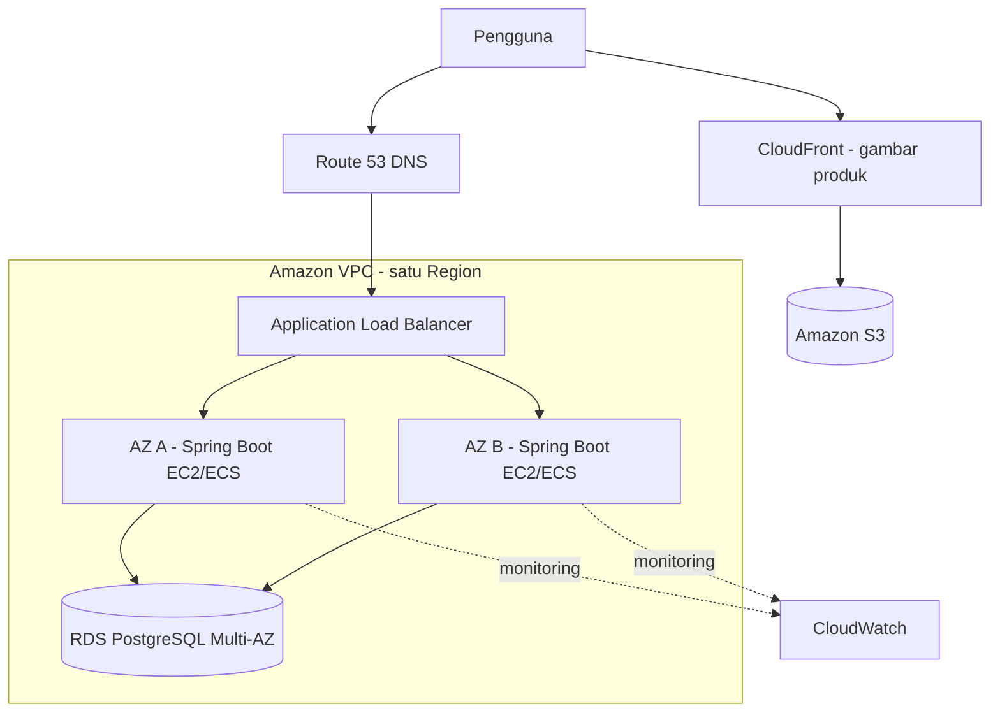
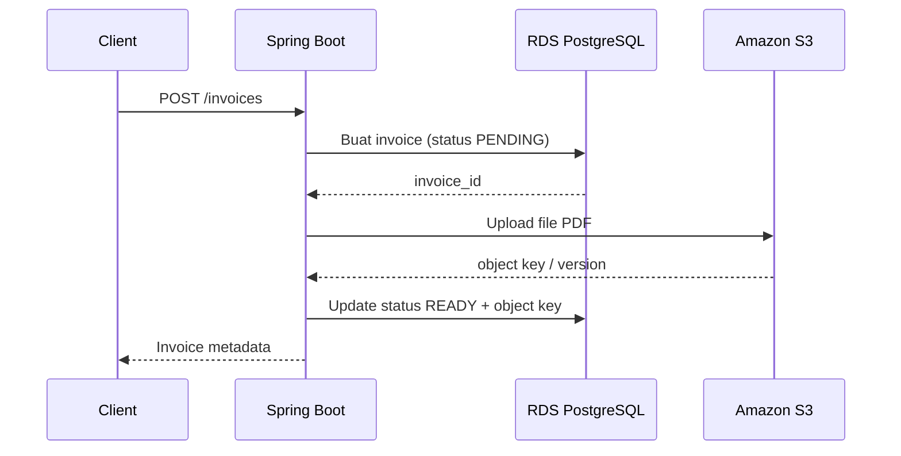
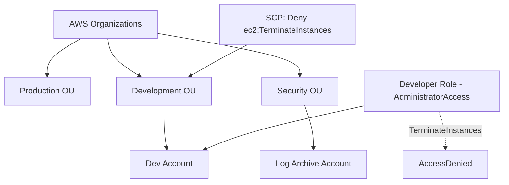

# Module 01 - Studi Kasus Arsitektur untuk Backend Java / Spring Boot

Dokumen ini menerjemahkan prinsip AWS Fundamentals menjadi keputusan yang harus dibuat oleh Senior Backend Developer. Diagram berikut bersifat konseptual, bukan deployment template lengkap.

## Case Study 1: E-commerce API dengan High Availability

**Kebutuhan:** API transaksi harus tetap berfungsi jika satu Availability Zone mengalami gangguan; menyimpan data pada PostgreSQL; menampilkan gambar produk ke pelanggan global.



> Diagram tidak memuat seluruh subnet, network routes, security groups, RDS topology, ataupun edge flow. Dalam implementasi nyata, ALB biasanya ditempatkan pada public subnets dan application instances pada private subnets.

### Mengapa Multi-AZ?

- Kegagalan satu AZ tidak harus menghentikan semua target aplikasi.
- ALB memerlukan konfigurasi target groups dan health checks yang sesuai.
- AZ lain harus mempunyai kapasitas untuk memproses request saat failover.
- Database membutuhkan strategy failover sendiri. Multi-AZ RDS berbeda dari read replicas: tujuan utama Multi-AZ adalah high availability, bukan otomatis meningkatkan kapasitas read.

### Session dan file upload

Jangan menyimpan session hanya dalam RAM salah satu EC2 apabila load balancing bisa memindahkan request ke instance lain. Pertimbangkan session stateless/JWT atau external session store yang sesuai. Jangan menaruh gambar produk hanya pada disk lokal EC2; gunakan S3 object storage dan terapkan akses terkontrol.

### Trade-off

| Keputusan | Benefit | Cost/risk |
|---|---|---|
| Single-AZ | Lebih sederhana dan berpotensi lebih murah | Kegagalan AZ berdampak besar |
| Multi-AZ + ALB | Availability lebih baik | Resource cadangan, data transfer, health checks |
| Multi-Region | Perlindungan lebih luas untuk gangguan Region | Konsistensi data, replikasi, DNS failover, biaya |
| CloudFront + S3 | Pengiriman static assets lebih cepat | Cache invalidation, request/egress cost |

### Hal yang perlu diuji

1. Matikan atau hentikan target aplikasi secara terkontrol; verifikasi health checks dan failover.
2. Lakukan load test saat kapasitas salah satu AZ hilang.
3. Uji RDS failover dan perilaku retry serta connection pool pada aplikasi.
4. Uji graceful shutdown Spring Boot untuk menghindari request terputus ketika deployment.
5. Pastikan S3 bucket tidak public hanya untuk memudahkan distribusi konten; gunakan kontrol origin access yang didukung.

## Case Study 2: Invoice Service, Object Storage, dan Database

**Kebutuhan:** invoice PDF disimpan durable; transaksi disimpan dalam PostgreSQL; API Java mengirim tautan unduhan terotorisasi.



**Keputusan penting:** Upload S3 dan transaksi PostgreSQL tidak otomatis berada dalam satu ACID transaction. Karena itu desain ideal mempertimbangkan idempotency keys, retry yang aman, status `PENDING`/`READY`/`FAILED`, serta pembersihan orphaned objects.

Contoh schema sederhana:

```sql
CREATE TABLE invoices (
    id BIGSERIAL PRIMARY KEY,
    customer_id BIGINT NOT NULL,
    invoice_number VARCHAR(60) NOT NULL UNIQUE,
    status VARCHAR(20) NOT NULL,
    total_amount NUMERIC(15,2) NOT NULL,
    s3_object_key VARCHAR(512),
    created_at TIMESTAMPTZ NOT NULL DEFAULT NOW()
);
```

### Contoh Java - AWS SDK for Java v2

```java
import java.nio.file.Path;
import software.amazon.awssdk.services.s3.S3Client;
import software.amazon.awssdk.services.s3.model.PutObjectRequest;

public class InvoiceUploader {
    private final S3Client s3;
    private final String bucket;

    public InvoiceUploader(S3Client s3, String bucket) {
        this.s3 = s3;
        this.bucket = bucket;
    }

    public String upload(Path pdf, String invoiceId) {
        String key = "invoices/" + invoiceId + ".pdf";
        s3.putObject(
            PutObjectRequest.builder()
                .bucket(bucket)
                .key(key)
                .contentType("application/pdf")
                .build(),
            pdf
        );
        return key;
    }
}
```

**Catatan production:** Injeksi `S3Client` yang menggunakan default credentials provider chain sesuai lingkungan runtime. Gunakan IAM Role dan permissions minimum pada prefix yang tepat; jangan menaruh key permanen di source code. Implementasikan checksum bila relevan, metadata keamanan, size limits, retry/idempotency, error handling, dan transaksi status di service layer.

Untuk akses unduh, pilih pola seperti backend proxy atau URL bertanda tangan dengan kedaluwarsa singkat sesuai model otorisasi aplikasi. Jangan menganggap URL yang disembunyikan merupakan kontrol akses.

## Case Study 3: Multi-Account Governance dan SCP

**Kebutuhan:** organisasi memiliki Development, Production, dan Security Accounts. Developer boleh mengelola EC2 Development tetapi tidak boleh melakukan terminate instance melalui IAM Role biasa di OU Development.



Contoh SCP:

```json
{
  "Version": "2012-10-17",
  "Statement": [
    {
      "Sid": "PreventInstanceTermination",
      "Effect": "Deny",
      "Action": "ec2:TerminateInstances",
      "Resource": "*"
    }
  ]
}
```

**Evaluasi:** IAM `AdministratorAccess` tidak membatalkan SCP explicit Deny yang berlaku. SCP membatasi permission maksimum, bukan memberikan izin.

**Security caveats:** Management Account tidak dibatasi SCP; AWS service-linked roles dikecualikan. Operasi terkelola seperti Auto Scaling dapat menggunakan service-linked roles, sehingga kebijakan ini tidak sama dengan 'mustahil ada instance yang dihentikan'. Uji kebutuhan operational recovery, deployment, dan cleanup sebelum memberlakukan Deny di OU.

### Alternative governance

- Organizations untuk hierarchy, billing, dan policies.
- Control Tower untuk baseline landing zone, provisioning, dan governance.
- RAM untuk share subnet VPC yang didukung dari Networking Account.
- CloudTrail untuk audit AWS API management events; konfigurasi data events bila butuh audit akses objek S3.
- AWS Config untuk riwayat konfigurasi dan evaluasi compliance.

## Case Study 4: Cost Planning sebelum dan sesudah Deployment

Arsitektur rencana: dua compute instances Spring Boot, ALB, RDS PostgreSQL, S3, dan biaya transfer data.

**Angka di bawah hanya ilustrasi untuk latihan, bukan tarif AWS terkini.**

| Item | Contoh asumsi | Estimasi / bulan |
|---|---|---:|
| Compute | 2 instance x 730 jam x USD 0.10/jam | USD 146 |
| Database | 730 jam x USD 0.20/jam | USD 146 |
| ALB | Asumsi biaya bulanan | USD 25 |
| S3 | Asumsi biaya bulanan | USD 12 |
| Data transfer | Asumsi biaya bulanan | USD 90 |
| **Total ilustratif** | | **USD 419** |

Estimasi ini sengaja tidak mencakup seluruh komponen biaya. Untuk hitungan riil, tambahkan storage EBS/RDS, backup, NAT, request, ALB capacity units, monitoring, data transfer antar-AZ, pajak, dan model diskon yang sesuai.

### Tool pada setiap fase

| Fase | Tool | Pertanyaan |
|---|---|---|
| Perencanaan | Pricing Calculator | Berapa estimasi rancangan A vs B? |
| Deployment | CloudFormation | Bagaimana membuat konfigurasi reproducible? |
| Operasional | Cost Explorer | Resource apa yang menyebabkan kenaikan biaya? |
| Kontrol anggaran | AWS Budgets | Kapan harus mengirim alert threshold? |
| Detail audit biaya | CUR / Data Exports | Bagaimana analisis granular menurut akun dan usage type? |

**Contoh pengambilan keputusan Senior Backend Developer:** RDS tampak mahal. Sebelum mengurangi ukuran instance, ukur p95 latency, query slow log, connection pool saturation, dan query plans. Penurunan kapasitas yang menghemat biaya tetapi merusak SLA bukan optimasi arsitektur yang benar.

## Latihan mandiri

1. Gambarkan single-AZ dan Multi-AZ topology untuk Spring Boot, lalu jelaskan blast radius setiap komponen.
2. Buat budget alert dan perkirakan biaya awal layanan dengan Pricing Calculator sebelum deploy.
3. Tuliskan contoh least-privilege IAM Role untuk izin upload hanya pada prefix `invoices/`.
4. Buat tabel perbedaan log aplikasi, CloudWatch, CloudTrail, dan Config saat sebuah instance tiba-tiba berhenti.
5. Rancang cara mengatasi S3 upload berhasil tetapi commit database gagal.

## Referensi

- [AWS Well-Architected](https://docs.aws.amazon.com/wellarchitected/latest/framework/welcome.html)
- [AWS Organizations SCP](https://docs.aws.amazon.com/organizations/latest/userguide/orgs_manage_policies_scps.html)
- [AWS S3 SDK for Java v2](https://docs.aws.amazon.com/sdk-for-java/latest/developer-guide/java_s3_code_examples.html)
- [AWS RDS Multi-AZ](https://docs.aws.amazon.com/AmazonRDS/latest/UserGuide/Concepts.MultiAZ.html)
- [Amazon CloudFront](https://docs.aws.amazon.com/AmazonCloudFront/latest/DeveloperGuide/Introduction.html)
- [AWS Pricing Calculator](https://calculator.aws/)
- [AWS Cost Explorer](https://docs.aws.amazon.com/cost-management/latest/userguide/ce-what-is.html)
